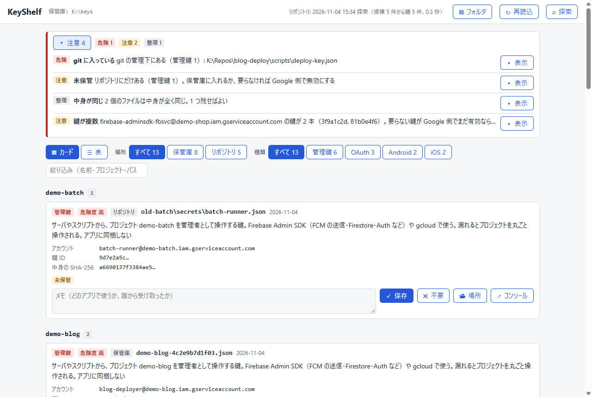
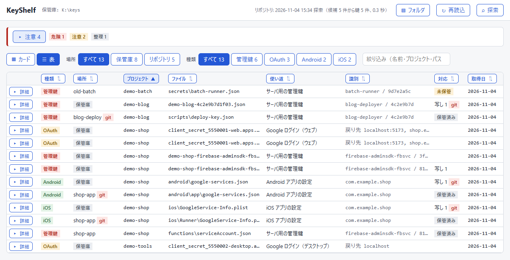

# KeyShelf

Google Cloud / Firebase からダウンロードした鍵や設定のファイルを、**中身で見分けて一覧にする**、読むだけのローカルの道具。

`client_secret_123…(1).json`、`xxx-firebase-adminsdk-a1b2c.json`、`google-services.json` …… と溜まっていくと、
どれが何の鍵で、どれが古く、どのリポジトリに写しがあるのかが分からなくなる。KeyShelf はファイルを開いて中身を読み、

- **何のファイルか**（サービスアカウントの鍵、OAuth の登録、Android / iOS の設定など）と、**何に使うものか**を文で示す
- **重複**（中身が同じ、同じ登録を指す、同じアカウントに鍵が複数ある）を知らせる
- リポジトリを探して、**写しがどこにあるか**、**git に入ってしまっている鍵**、**手元にしか無い鍵**を知らせる

ファイルを消したり動かしたりはしない。秘密の値は画面にも出力にも出さない。



## 動かす

Windows 向け。Python 3.11 以上と [uv](https://docs.astral.sh/uv/) が要る。依存は標準ライブラリだけ。

```powershell
git clone https://github.com/lancard-aikawa/KeyShelf.git
cd KeyShelf
uv run keyshelf serve      # http://127.0.0.1:20002/ をブラウザで開く
```

`run-keyshelf.cmd` をダブルクリックしても同じ（既に動いていればブラウザだけ開く）。窓を閉じるか Ctrl+C で止まる。

初回は、ダウンロードした鍵の置き場（**保管庫**）として `%USERPROFILE%\KeyShelf` を作る。鍵をそこへ入れるか、
画面右上の「フォルダ」で今の置き場を指定する。

## 見分けるファイル

| 画面の名前 | ファイル | 秘密度 |
|---|---|---|
| 管理鍵 | サービスアカウントの鍵（`type: service_account`） | 高 |
| ログイン情報 | `gcloud auth application-default login` の結果（`type: authorized_user`） | 高 |
| OAuth | `client_secret_*.json`（web / installed） | 中 |
| 通信記録 | HAR（ブラウザの通信の記録。トークンが入りうる） | 中 |
| Android | `google-services.json` | 低 |
| iOS | `GoogleService-Info.plist` | 低 |

## フォルダは 2 種類

- **保管庫**: ダウンロードした鍵をしまっておく所（正本）。`.json` と `.plist` をサブフォルダまですべて読む
- **リポジトリ**: 鍵が使われている所（写し）。既定は `%USERPROFILE%\source\repos`・`%USERPROFILE%\repos`・
  `%USERPROFILE%\src`・`C:\Repos` のうち在るもの。鍵の形をしたファイルだけ拾い、保管庫にもあるか（保管済み / 未保管）と、
  git の管理下かを付ける

どちらも複数持てる。画面の「フォルダ」で足し引きする（外してもファイルは消さない）。



画面の例は、偽の鍵で作った見本のフォルダ（`K:\keys` と `K:\Repos`）を読んだもの。

## 守っていること

- **読むだけ。**ファイルを消さない・動かさない。「不要」の印とメモは `%USERPROFILE%\.keyshelf\notes.json` に付けるだけ
- **秘密の値を出さない。**秘密鍵・client_secret・API キー・トークンは画面にも JSON にも入れない。鍵 ID は先頭 8 文字だけ
- **外に何も送らない。**サーバは `127.0.0.1` だけで待ち、`Host` を確かめ、POST は JSON だけ受け付ける
- **走査するファイルとリポジトリを信用しない。**git はリポジトリ側の設定でコマンドが動かないようにして呼ぶ

## コマンドと設定

```powershell
uv run keyshelf list                 # ターミナルに一覧
uv run keyshelf list --json          # JSON（秘密の値は入らない）
uv run keyshelf list --no-copies     # リポジトリを探さない
uv run keyshelf list --shelf D:\keys --root D:\Repos   # 設定の代わりにフォルダを指定（くり返し可）
```

設定は `%USERPROFILE%\.keyshelf\config.json`。画面の「フォルダ」で変えるとここに書く。

```json
{ "shelves": ["D:\\keys"], "roots": ["D:\\Repos"], "port": 20002 }
```

試験は `uv run pytest -q`。

## ライセンス

MIT（[LICENSE](LICENSE)）
